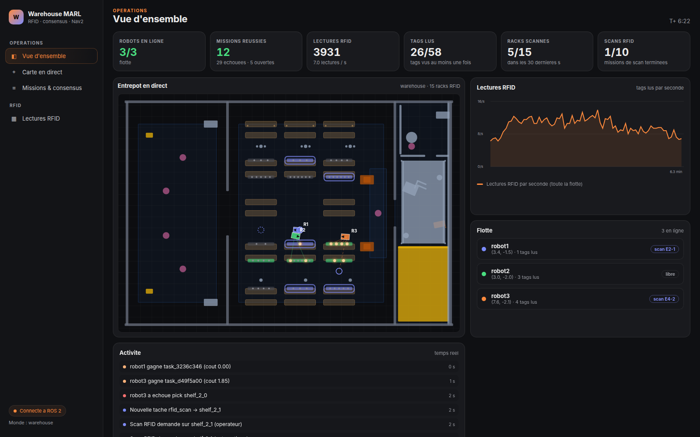
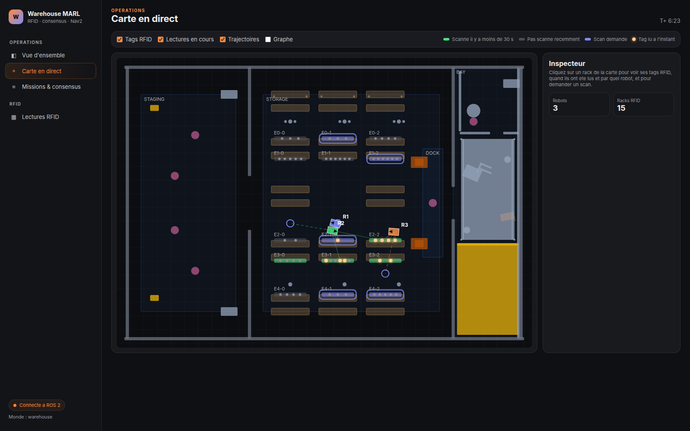
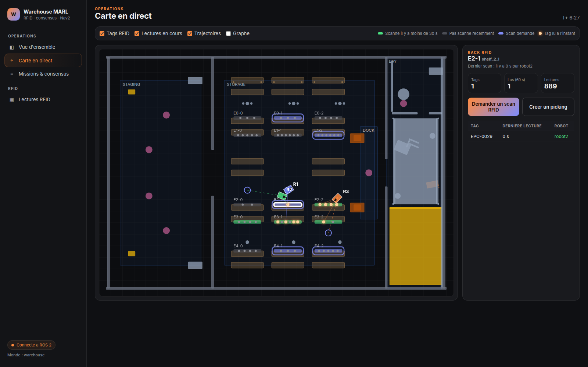
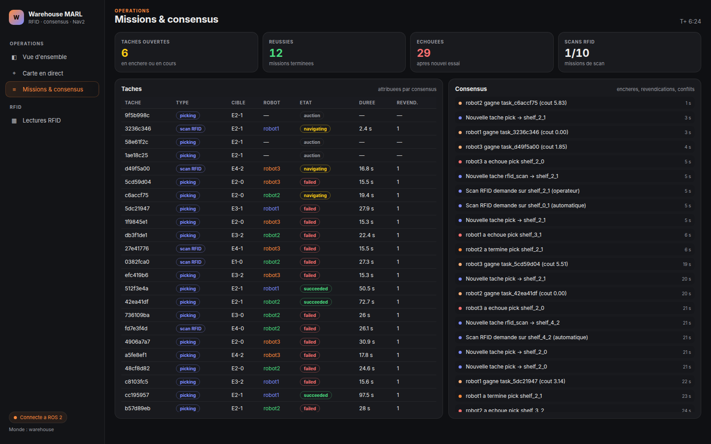
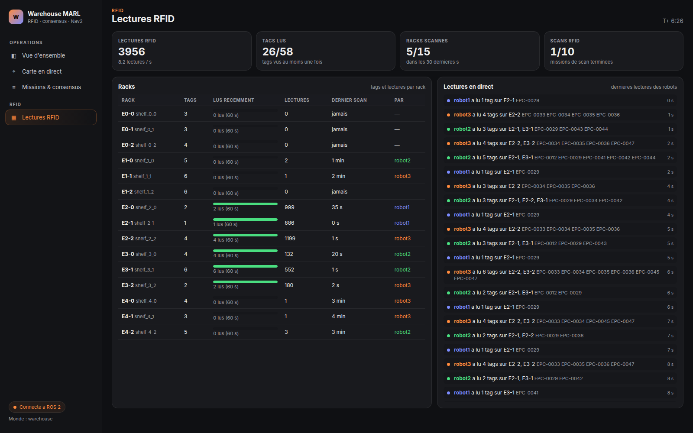

# Multi-Robot RFID Warehouse (ROS 2)

A simulated warehouse in which several autonomous robots share the work.
The robots map the building, take orders, decide among themselves who
does each job, and keep a live inventory using RFID readers. Everything
can be watched in Gazebo, in RViz or in a web dashboard.

The project follows the thesis subject: *the warehouse is modelled as a
dynamic graph where autonomous agents collaborate through consensus-based
protocols, with RFID-based sensing and IoT communication layers enabling
adaptive decision-making under uncertain conditions.*

Stack: ROS 2 Jazzy, Gazebo Harmonic, Nav2, slam_toolbox, Python.


---

## Features

### Simulation and navigation (`rosnav_bot`)
- **Gazebo warehouse world** with racks, aisles and shelves, and 3 to 5
  differential-drive robots (2D lidar, IMU, depth camera).
- **Mapping and localization:** robot1 builds the shared map with
  slam_toolbox, and the other robots localize on it with AMCL. A
  per-robot SLAM mode with map merging is also available.
- **Autonomous exploration:** a frontier coordinator gives each robot a
  different unexplored area, so the map is built in parallel.
- **Nav2 navigation per robot:** path planning (NavFn), MPPI controller,
  recovery behaviors, a velocity smoother, and a collision monitor that is
  the last safety check before the wheels.
- **Robot-to-robot awareness:** the robots are lower than the lidars, so
  they cannot see each other. The `fleet_obstacles` node adds every
  robot's footprint to the others' costmaps.
- **Safe spawning:** start positions are checked against the world and
  kept apart from each other.
- **Map from the world file:** `world_to_map.py` can build an exact map
  straight from the Gazebo world, so the robots can work without
  exploring first.
- **Lifecycle watchdog:** restarts Nav2, SLAM or map_server nodes that
  get stuck while starting.

### Multi-agent coordination, MARL (`warehouse_marl`)
- **Dynamic graph:** racks, aisles and stations are graph nodes, paths
  are edges. The graph is updated live with robot positions and
  congestion, and all costs are computed on it.
- **Consensus-based task allocation:** each robot runs its own consensus
  node. There is no central dispatcher. Robots bid on each new task, the
  lowest cost wins, and the protocol handles late bids, double claims and
  rack capacity (two robots are never sent to the same rack).
- **Task generator:** creates pick/deliver tasks and RFID scan tasks.
- **Mission executor:** turns a won task into a Nav2 goal, retries on
  failure, and reports the task status.
- **DRL allocator (optional):** a DQN policy, trained offline, that can
  guide the bids (`hybrid`) or allocate directly (`direct`). The default
  `heuristic` mode needs no model.

### RFID
- Every item on the racks carries an RFID tag.
- Every robot carries an RFID reader that reads the nearby tags as it
  drives along the racks.
- The inventory node combines all the reads into the current stock of
  each rack.
- **RFID scan missions:** a rack that needs checking becomes a scan
  task. The robots win it through consensus like any other task, and one
  of them drives along the rack to read its tags. Scans are requested
  automatically, or by an operator from the dashboard.
- **IoT layer:** readers, robots and the dashboard all communicate over
  ROS 2 topics.

### Web dashboard
- Live dashboard at **http://localhost:8080**, started automatically.
  It needs no extra installation.
- **Views** (the dashboard labels are in French):
  - **Overview:** KPIs, fleet, activity.
  - **Live map:** robots, paths, racks, RFID tags lighting up when they
    are read.
  - **Missions & consensus:** tasks, winners, durations, resolved
    conflicts.
  - **RFID reads:** per rack, plus a live feed of reads.
- **Operator actions:** click a rack to request an RFID scan or create a
  pick task. Both go through the normal consensus.

---

## Repository layout

```text
src/
├── rosnav/src/rosnav_bot/   simulation, robots, SLAM/AMCL, Nav2, exploration
│   ├── launch/              multi_robot.launch.py (fleet), Nav2 launch files
│   ├── config/              Nav2, AMCL, SLAM, EKF parameters
│   ├── worlds/              warehouse.world and other worlds
│   └── scripts/             frontier_coordinator, fleet_obstacles, world_to_map, ...
└── warehouse_marl/          coordination, RFID, DRL, dashboard
    ├── launch/              warehouse_full.launch.py (everything), warehouse_marl.launch.py
    ├── warehouse_marl/      ROS nodes (consensus, RFID, inventory, tasks, dashboard, ...)
    ├── dashboard/           web page (HTML/CSS/JS)
    └── doc/                 architecture diagram, screenshots, RFID results
FIXES.md                     log of bugs found and fixed, with test steps
```

`warehouse_bringup`, `warehouse_description`, `warehouse_navigation` and
`warehouse_slam` are the older Humble / Gazebo Classic packages. They are
not used by the current system.

---

## Installation

You need Ubuntu 24.04 with **ROS 2 Jazzy** and **Gazebo Harmonic**.

```bash
sudo apt install ros-jazzy-desktop ros-jazzy-ros-gz \
  ros-jazzy-navigation2 ros-jazzy-nav2-bringup ros-jazzy-slam-toolbox \
  ros-jazzy-robot-localization ros-jazzy-laser-filters \
  ros-jazzy-pointcloud-to-laserscan python3-numpy python3-scipy python3-yaml

# Optional, only to train or use the DRL policy
pip install gymnasium torch
```

Build from the workspace root (the folder that contains `src/`):

```bash
cd ~/warehouse/warehouse-ros2
source /opt/ros/jazzy/setup.bash
colcon build --symlink-install --packages-select rosnav_bot warehouse_marl
source install/setup.bash
```

Run `source install/setup.bash` in every new terminal.

---

## How to run

### Everything with one command

```bash
ros2 launch warehouse_marl warehouse_full.launch.py
```

This starts Gazebo, RViz, 3 robots with navigation and exploration, the
coordination and RFID layer, and the dashboard. The robots start moving
after about a minute, and missions begin once the map is ready.

Common variants:

```bash
ros2 launch warehouse_marl warehouse_full.launch.py robot_count:=4       # 4 robots (up to 5)
ros2 launch warehouse_marl warehouse_full.launch.py explore:=false       # no exploration, missions only
ros2 launch warehouse_marl warehouse_full.launch.py marl:=false          # simulation and navigation only
ros2 launch warehouse_marl warehouse_full.launch.py headless:=true rviz:=false   # lighter, no 3D windows
```

### Launch arguments

| Argument | Default | Meaning |
|---|---|---|
| `robot_count` | `3` | Number of robots (`robot1`…`robotN`), 3 recommended, up to 5 |
| `explore` | `true` | Frontier exploration. `false`: robots wait for missions (the map is then built from the world file if no saved map exists) |
| `slam_mode` | `single` | `single`: SLAM on robot1 + AMCL. `multi`: SLAM on every robot + map merging |
| `merge_scans` | `true` | Merge all robots' scans into `/map_fused` |
| `headless` | `false` | Gazebo without its window |
| `rviz` | `true` | Start RViz |
| `marl` | `true` | Start the coordination / RFID layer |
| `drl_mode` | `heuristic` | Allocation: `heuristic`, `hybrid` or `direct` |
| `model_path` | `warehouse_dqn.pt` | DQN model for `hybrid` / `direct` |
| `dashboard` | `true` | Start the web dashboard |
| `dashboard_port` | `8080` | Dashboard port |
| `map_origin_x/y` | `-1.5` / `-1.0` | Gazebo position of robot1's spawn (map origin) |

### Stopping cleanly

Press `Ctrl+C` in the launch terminal. Gazebo sometimes keeps running in
the background, and leftover processes disturb the next run. Check before
starting again:

```bash
ps -eo pid,args | grep -E "gz sim|/opt/ros/jazzy/lib/" | grep -v grep
bash src/rosnav/src/rosnav_bot/scripts/kill_rosnav_sim.sh   # cleans up leftovers
```

---

## How to see it

| Where | What you see |
|---|---|
| **Gazebo** | The 3D warehouse and the real robot positions |
| **RViz** | The map being built, each robot's estimated position, laser scans, planned paths and costmaps |
| **Dashboard** at http://localhost:8080 | The operator view: live map, missions, consensus and RFID reads |

RViz and Gazebo are for developers. The **web dashboard** is the
operator's view of the whole system.

---

## The web dashboard

Open **http://localhost:8080** once the system is running. The
screenshots below come from a real run (3 robots, about 6 simulated
minutes). The interface is in French; English meanings are given below.

### How it works

```text
ROS 2 topics ──► dashboard_server (ROS node) ──► browser (HTML/JS/SVG)
   robots (TF), tasks, consensus,      │   state pushed twice a second (/api/stream)
   RFID reads, inventory               │
                                       ◄── buttons: POST /api/scan, /api/pick
                                           → published on ROS topics
```

- `dashboard_server.py` is an ordinary ROS 2 node. It subscribes to the
  robots' positions, the tasks and consensus messages, and the RFID
  reads. It keeps a live snapshot of the warehouse and serves the web
  page itself, so it needs no Node.js, rosbridge or database.
- The warehouse plan (walls, zones, racks, tag positions) is read once
  from the Gazebo world file, so the map matches the simulation exactly.
- The browser receives the state about twice a second over Server-Sent
  Events (`/api/stream`), so the page updates with no reload.
- The buttons do not control robots directly. They publish a normal
  request on a ROS topic, so an operator request goes through the same
  consensus as any other task.

Racks are named `E<row>-<column>` on screen (for example `E2-1`), which
is `shelf_<row>_<column>` in ROS (`shelf_2_1`).

### Views

**Vue d'ensemble (overview):**



- KPIs: robots online, missions succeeded/failed/open, total RFID reads,
  tags seen, racks scanned in the last 30 s, scan missions completed.
- A compact live map, the fleet-wide RFID reads per second, each
  robot's position and current job, and an activity feed (new tasks,
  auction winners, completed and failed missions, scan requests).

**Carte en direct (live map):**



- The warehouse drawn from the Gazebo world (staging area, storage
  racks, dock).
- Robots (R1, R2, R3) with their path to their current goal (dashed
  line, target circle).
- RFID tags as dots on the racks: they glow orange at the moment they
  are read, and orange lines link a robot to the tags it is reading.
- Rack colours: green = scanned in the last 30 s, grey = not scanned
  recently, blue outline = scan requested.
- Checkboxes show or hide tags, current reads, paths and the graph.

**Rack detail (click a rack):**



- The rack's tags, which robot read each one and how long ago, and the
  number of reads.
- Two buttons: **Demander un scan RFID** (request an RFID scan) and
  **Creer un picking** (create a pick task).

**Missions & consensus:**



- **Taches** (tasks): every task with its type (picking or scan RFID),
  target rack, winning robot, state (`auction`, `navigating`,
  `succeeded`, `failed`), duration, and number of competing claims
  (`REVEND.`).
- **Consensus** feed: new tasks, which robot won each auction and at
  what cost, completed and failed missions.

**Lectures RFID (RFID reads):**



- Per rack: number of tags, tags read in the last 60 s, total reads,
  last scan and by which robot.
- Live feed of every read: robot, rack(s) and tag IDs (`EPC-…`).

Each view has its own URL: `#overview`, `#map`, `#missions`, `#reads`,
or one rack directly, e.g. `#map/shelf_2_1`.

### Sending a task to read RFID tags

There are three ways to ask the robots to scan a rack. They all end up
as the same request on the `/rfid/scan_requests` topic.

**1. From the dashboard (easiest).** Open **Carte en direct**, click a
rack, press **Demander un scan RFID**. A confirmation pops up and the
rack gets a blue outline.

**2. From a terminal, through the dashboard's API:**

```bash
curl -X POST http://localhost:8080/api/scan \
     -H 'Content-Type: application/json' -d '{"shelf": "shelf_2_1"}'
```

**3. Directly on the ROS topic:**

```bash
ros2 topic pub --once -w 1 /rfid/scan_requests std_msgs/msg/String \
  '{data: "{\"shelf\": \"shelf_2_1\", \"source\": \"dashboard\"}"}'
```

`-w 1` waits until the system is listening before publishing.
`"source": "dashboard"` marks the request as coming from an operator: it
is then accepted even if that part of the map is not explored yet. It is
also shown as *operateur* (operator) in the activity feed.

A pick task can be created the same way, with the dashboard's
**Creer un picking** button or with
`curl -X POST http://localhost:8080/api/pick -H 'Content-Type: application/json' -d '{"shelf": "shelf_2_1", "priority": 1.5}'`.

**What happens next** (all visible on the dashboard):

1. The task generator turns the request into an `rfid_scan` task
   (activity feed: *Nouvelle tache rfid_scan → shelf_2_1*).
2. Every free robot bids its path cost. After the auction window, the
   cheapest robot wins (*robot1 gagne task_… (cout …)*). The task shows
   `navigating` in **Missions & consensus**.
3. The mission executor sends the robot to the rack face with Nav2.
4. While it drives along the rack, its RFID reader picks up the tags:
   they glow on the live map and appear in the **Lectures RFID** feed.
5. The inventory node updates the stock of that rack. The rack turns
   green (just scanned) and the task ends as `succeeded`.

In the screenshots, the operator scan of `E2-1` was won by robot1 and
finished as `succeeded`.

The system also creates scan tasks by itself, for racks that need
checking; these appear as *automatique* in the feed.

The dashboard can also be started on its own (with the rest of the
system already running):

```bash
ros2 run warehouse_marl warehouse_dashboard --ros-args -p use_sim_time:=true
```

## Useful topics

```bash
ros2 topic echo /warehouse/tasks/new              # new tasks
ros2 topic echo /warehouse/consensus/assignments  # who won which task
ros2 topic echo /warehouse/tasks/status           # queued / navigating / succeeded / failed
ros2 topic echo /warehouse/graph_state            # dynamic graph
ros2 topic echo /rfid/scans                       # raw RFID reads per robot
ros2 topic echo /rfid/inventory                   # stock per rack
ros2 topic echo /rfid/scan_requests               # shelves chosen for a scan
```

---

## Training the DRL policy

Train offline (no Gazebo needed), then start the system with the model:

```bash
ros2 run warehouse_marl train_drl --episodes 500 --n-agents 3 --out warehouse_dqn_3robots.pt
ros2 launch warehouse_marl warehouse_full.launch.py drl_mode:=hybrid model_path:=$PWD/warehouse_dqn_3robots.pt
```

---

## Known limitations

- **Position drift:** when robots push each other or get stuck, the
  position shown in RViz and on the dashboard can lag the real Gazebo
  position by 1–3 m until localization corrects it. It is reduced, not
  solved; see "Robot position drift" in `FIXES.md`.
- **Machine load:** 4–5 robots need a strong machine. With 3 robots, use
  `headless:=true rviz:=false` if the simulation runs slower than real
  time.
- **Simulated RFID:** the RFID reader is simulated in software, not a
  Gazebo sensor plugin.
- **Scan missions do not handle items:** the robots have no arm.
- **High-level DRL:** the DRL policy allocates tasks. It does not drive
  the wheels; Nav2 does that.

## More documentation

- `src/warehouse_marl/README.md`: detailed design of consensus, RFID
  model and dashboard (in French).
- `FIXES.md`: every bug found, its cause, the fix, and how to test it.
