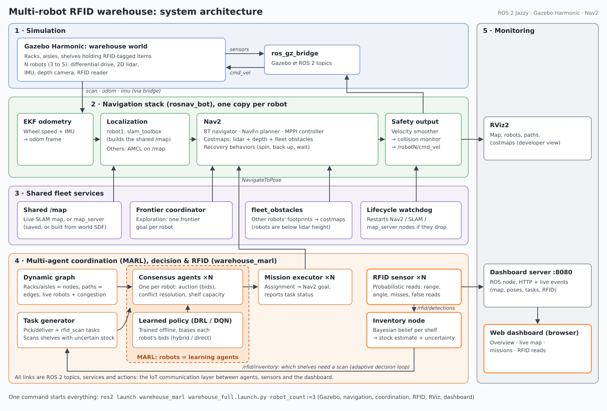

# warehouse_marl

Package ROS2 (Humble / Jazzy) implementant la couche **coordination
distribuee multi-agents + DRL + RFID/IoT** demandee par le sujet de Master
*"Intelligent Distributed Multi-Agent Coordination for Autonomous Smart
Warehousing in Industry 4.0"* (ARTI, ENIT/INSAT, 2025/2026).

Ce package est concu pour se greffer **par-dessus** le socle de simulation
et de navigation ROS2 [`rosnav`](https://github.com/darshmenon/rosnav)
(Nav2 + SLAM Toolbox + Gazebo Harmonic, monde `warehouse` fourni), qui
gere la couche bas niveau (perception, evitement d'obstacles, deplacement
physique). `warehouse_marl` ajoute la couche haut niveau : graphe
dynamique, RFID, consensus distribue, allocation par DRL.

## Correspondance avec le sujet de Master

| Exigence du sujet | Fichier(s) |
|---|---|
| Entrepot modelise comme un graphe dynamique | `warehouse_marl/warehouse_graph.py` |
| Couche de detection RFID | `warehouse_marl/rfid_model.py`, `rfid_sensor_node.py`, `inventory_node.py` (voir "Couche RFID") |
| Couche de communication IoT | topics ROS 2 (DDS publish/subscribe) en JSON : `/rfid/*`, `/warehouse/*` |
| Decision adaptative | missions de scan RFID declenchees selon l'etat des racks (`inventory_node.py`, `task_generator_node.py`) |
| Protocole de coordination distribue base sur consensus | `warehouse_marl/consensus_node.py` |
| Framework DRL pour l'allocation de taches et le path planning | `warehouse_marl/drl/env.py`, `dqn_agent.py`, `train_drl.py`, `drl_allocator_node.py` |
| Validation par simulation a grande echelle | `launch/warehouse_marl.launch.py` + monde `warehouse` de rosnav |
| Reduction du temps de traitement / taux d'erreur vs heuristique | comparer les modes `heuristique seul` / `hybrid` / `direct` (voir plus bas) |

## Architecture



Vue d'ensemble : simulation Gazebo, pile de navigation par robot, services partages de la flotte, coordination par consensus + couche RFID, et supervision (RViz, tableau de bord web). Version PNG : `doc/architecture.png`.

```
                     ┌────────────────────────┐
                     │   task_generator_node   │  (flux de commandes)
                     └────────────┬────────────┘
                                  │ /warehouse/tasks/new
                                  ▼
   ┌──────────────┐   ┌─────────────────────┐    ┌──────────────────┐
   │ rfid_sensor  │   │ graph_publisher_node │    │ drl_allocator_node│
   │    _node     │──▶│  (graphe dynamique)   │◀──│  (politique DQN)  │
   └──────────────┘   └──────────┬───────────┘    └─────────┬─────────┘
      /rfid/detections           │ /warehouse/graph_state    │ /warehouse/consensus/bid_bias
                                  ▼                            │
                  ┌───────────────────────────┐                │
                  │  consensus_node (x N)      │◀───────────────┘
                  │  un noeud PAR agent robot   │
                  └──────────────┬─────────────┘
                                  │ /warehouse/consensus/bids
                                  │ /warehouse/consensus/assignments
                                  ▼
                  ┌───────────────────────────┐
                  │ mission_executor_node      │
                  │ files + etat des taches   │
                  └──────────────┬────────────┘
                                 │ /robotN/navigate_to_pose
                                 ▼
                                Nav2
```

## Installation

```bash
# Dependances systeme ROS2 (Humble ou Jazzy)
sudo apt install ros-$ROS_DISTRO-rclpy ros-$ROS_DISTRO-std-msgs \
                  ros-$ROS_DISTRO-nav-msgs ros-$ROS_DISTRO-geometry-msgs

# Environnement Python partageant les paquets ROS systeme
python3 -m venv --system-site-packages .venv
source .venv/bin/activate

# Dependances optionnelles pour entrainer/utiliser le DQN
python -m pip install gymnasium torch

# Construction du workspace
cd ~/chaimaws/src/warehouse-ros2
python -m colcon build --symlink-install --packages-select rosnav_bot warehouse_marl
source install/setup.bash
```

## Utilisation

### 1) Entrainer la politique DRL (hors-ligne, pas besoin de ROS2/Gazebo)

```bash
ros2 run warehouse_marl train_drl --episodes 500 --n-agents 4 --out warehouse_dqn.pt
```

Produit `warehouse_dqn.pt` (poids du reseau) et `training_log.csv`
(courbe de convergence reward / cout moyen par episode -> directement
exploitable pour les figures de ton memoire).

### 2) Lancer la simulation (terminal 1, package rosnav)

```bash
ros2 launch rosnav_bot multi_robot.launch.py \
    world:=warehouse robot_count:=4 explore:=true slam_mode:=single \
    merge_scans:=true fleet_mgmt:=false
```

### 3) Lancer la couche de coordination (terminal 2, ce package)

```bash
ros2 launch warehouse_marl warehouse_marl.launch.py \
    robot_names:="['robot1','robot2','robot3','robot4']" \
    drl_mode:=heuristic \
    map_origin_x:=-1.5 map_origin_y:=-1.0
```

Le mode `heuristic` est le point de depart valide : il ne depend pas d'un
modele appris. Les coordonnees `map_origin_x/y` doivent etre celles du spawn
Gazebo de `robot1`; dans le monde `warehouse`, la validation de collision
deplace le spawn demande `(-2.0, -1.0)` vers le point libre
`(-1.5, -1.0)`, d'ou les valeurs ci-dessus. Le generateur attend que des points de picking
soient reellement libres et connus dans `/map_fused` (`/map` sert de repli), puis les missions suspendent
temporairement les objectifs d'exploration pendant qu'elles utilisent Nav2.

Apres une modification/reconstruction de `rosnav_bot`, relancer une fois la
simulation de base afin que le `frontier_coordinator` charge ce mecanisme de
pause.

### 4) Observer le systeme

```bash
ros2 topic echo /warehouse/tasks/new
ros2 topic echo /warehouse/consensus/assignments
ros2 topic echo /warehouse/tasks/status
ros2 topic echo /rfid/detections
ros2 topic echo /rfid/inventory
ros2 topic echo /warehouse/graph_state
```

## Tableau de bord web

Organisation inspiree du dashboard AMR-X (vue "command center", carte
extraite du monde Gazebo comme `extract-sdf-worlds.mjs`), avec un theme
propre : graphite neutre, accent orange securite, racks couleur bois ;
vert = rack scanne recemment, gris = pas scanne recemment, indigo = scan
demande. Il
demarre avec `warehouse_full.launch.py` ; ouvrir **http://localhost:8080**.
Seul : `ros2 run warehouse_marl warehouse_dashboard --ros-args -p use_sim_time:=true`.

Aucune installation supplementaire : le noeud `dashboard_server.py` sert la
page et pousse l'etat au navigateur (Server-Sent Events), sans rosbridge,
Node.js ni base de donnees.

| Vue | Contenu |
|---|---|
| Vue d'ensemble | KPI (robots, missions, lectures RFID, tags lus, racks scannes, missions de scan), carte compacte, lectures RFID par seconde, flotte, activite |
| Carte en direct | monde Gazebo, robots et trajectoires, tags RFID (allumes quand ils sont lus), lectures en cours, racks colores (scanne recemment / pas recemment / scan demande), cibles des missions ; clic sur un rack -> ses tags, derniere lecture et robot, actions |
| Missions & consensus | taches (type, cible, robot gagnant, etat, duree, conflits resolus), fil du consensus |
| Lectures RFID | par rack : tags, tags lus recemment, lectures, dernier scan et robot ; fil des lectures en direct |

Actions de l'operateur (passent par le systeme normal) :
- **Demander un scan RFID** -> `/rfid/scan_requests` -> tache `rfid_scan`
  attribuee par consensus ;
- **Creer un picking** -> `/warehouse/tasks/new` -> consensus.

Les vues sont adressables : `#overview`, `#map`, `#map/shelf_2_0`,
`#reads`, `#missions`. Captures : `doc/dashboard_*.png`.
Arguments du launch : `dashboard:=false`, `dashboard_port:=8080`.

## Protocole de consensus

Chaque robot execute un `consensus_node` ; aucun arbitre central.

1. **Enchere** : a chaque nouvelle tache, chaque agent libre calcule son
   cout (plus court chemin sur le graphe dynamique / priorite, + biais DRL
   eventuel) et le diffuse sur `/warehouse/consensus/bids`. Un agent libre
   n'encherit que sur une tache ouverte a la fois, la plus prioritaire.
2. **Capacite du graphe** : un agent n'encherit pas sur une tache dont le
   rack est deja vise par une autre tache en cours (capacite 1 par rack,
   2 a 4 pour les stations). Tous les agents comptent les memes
   attributions, donc prennent la meme decision ; deux robots ne sont plus
   envoyes au meme rack, ou ils se bloquaient mutuellement.
3. **Cloture** : apres 1,5 s, chaque agent retient localement le cout
   minimal recu (egalite -> robot_id). Si personne n'a encheri (tous les
   robots occupes), la tache reste **ouverte** ; la premiere enchere
   ulterieure relance la fenetre chez tous les agents.
4. **Resolution des conflits** : une enchere arrivee trop tard peut amener
   deux agents a se croire gagnants. Chaque revendication
   (`/warehouse/consensus/assignments`) porte son cout ; tous les agents et
   le `mission_executor_node` appliquent la meme regle (cout minimal, puis
   robot_id) et les perdants se retirent. L'executeur attend 0,5 s
   (`claim_window_sec`) apres la premiere revendication avant de lancer la
   mission.

## Couche RFID

- Chaque article des racks porte un tag RFID.
- Chaque robot embarque un lecteur RFID (`rfid_sensor_node`) qui lit les
  tags proches quand il passe le long des racks.
- Le noeud `inventory_node` combine toutes les lectures pour connaitre le
  stock de chaque rack.
- **Missions de scan RFID** : un rack a verifier devient une tache
  `rfid_scan`, attribuee par consensus comme les autres ; le robot gagnant
  longe le rack et lit ses tags. Les scans sont demandes automatiquement
  ou par l'operateur depuis le tableau de bord.

### Topics

| Topic | Contenu |
|---|---|
| `/rfid/detections` | lecture d'un tag de localisation (robot, noeud) |
| `/rfid/scans` | un cycle de lecture d'un robot : position + tags lus |
| `/rfid/inventory` | stock de chaque rack, dernier scan |
| `/rfid/scan_requests` | rack a scanner |

Demander un scan depuis un terminal :

```bash
ros2 topic pub --once -w 1 /rfid/scan_requests std_msgs/msg/String \
  '{data: "{\"shelf\": \"shelf_2_1\", \"source\": \"dashboard\"}"}'
```

## Modes d'allocation comparables (pour ton evaluation experimentale)

- **Heuristique pure** (`drl_mode:=heuristic`, recommande pour valider la
  simulation) : consensus par plus court chemin + priorite, sans modele.
- **DRL direct** : `drl_mode:=direct` -> allocation centralisee par
  argmax des Q-values (necessite un `model_path` valide).
- **Hybride** : `drl_mode:=hybrid` -> le DRL oriente les encheres, la
  decision finale reste distribuee. Sans modele valide, aucun poids aleatoire
  n'est utilise et le consensus reste heuristique.

Le topic `/warehouse/tasks/status` publie `queued`, `navigating`, `retrying`,
et un etat terminal (`succeeded`, `failed`, `rejected`, `canceled`) avec
`elapsed_sec`. Il permet de mesurer le temps physique creation -> fin, plus
pertinent que le seul temps d'allocation.

## Limites connues / pistes d'extension pour le memoire

- L'environnement DRL (`drl/env.py`) est un environnement **de haut
  niveau** (allocation), pas un controleur bas niveau : le DRL ne pilote
  pas directement les roues (delegue a Nav2/MPPI de rosnav). C'est un
  choix pedagogique raisonnable a justifier/discuter dans ton memoire.
- Le lecteur RFID est simule de maniere logicielle (pas de plugin
  Gazebo).
- Les missions de scan ne prelevent pas d'articles (pas de manipulateur).
- Le DQN peut etre remplace par un algorithme multi-agent plus avance
  (QMIX, MADDPG, PPO multi-agent) pour aller plus loin dans la partie
  recherche du memoire.
